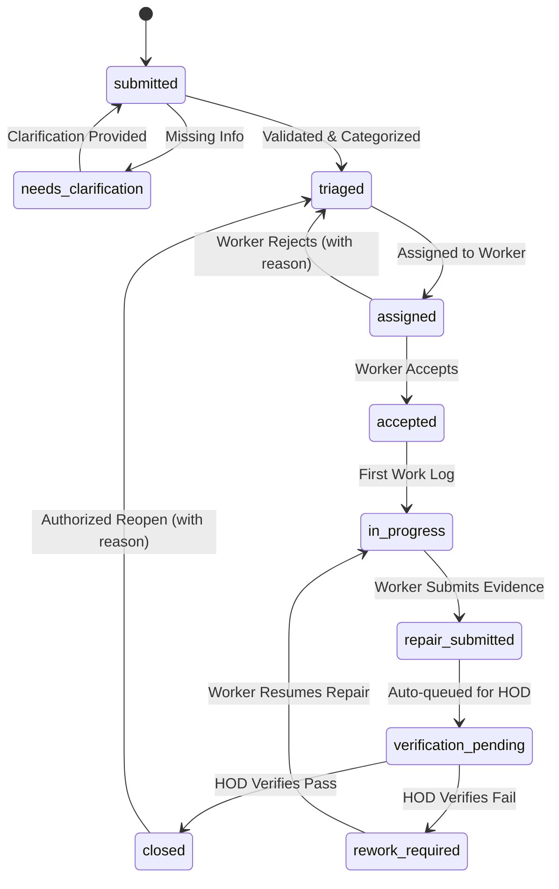

# CampusFix AI — Canonical API & Domain Contract (`/api/v1`)

> **Document Version:** `1.0.0-phase1-draft`  
> **Status:** `PROPOSED — PENDING TEAM APPROVAL`  
> **Target Branch:** `docs/p1-api-contract`  
> **Author:** Member 4 (CONTRACT_QA)  
> **Hackathon:** LECTRONX 26 Energy Conservation Hackathon (Problem Q071)

---

## 1. Overview & Non-Negotiable Core Rules

This document establishes the canonical API contract, domain types, state transition rules, authorization policies, and notification dispatch semantics for **CampusFix AI**.

### Core Architecture Principles
1. **Contract-First Development:** Frontend (`client/**`) and Backend (`server/**`) must build strictly against the routes, payloads, and response envelopes specified here.
2. **Fail Closed:** Any request lacking valid session authentication or insufficient role permissions returns `401 Unauthorized` or `403 Forbidden`. No UI-only privilege checking.
3. **Server-Side Session Identity:** Identity and roles are derived solely from the server-side session backed by database records. Client-provided role assertions are ignored.
4. **Deterministic & Safe Demo Mode:** Demo authentication endpoints are accessible only when `DEMO_AUTH_ENABLED=true` and `NODE_ENV !== 'production'`. Demo accounts resolve known synthetic database seed entries.
5. **No Secret Leaking:** Stack traces, internal DB connection strings, and credential secrets are strictly scrubbed from all API responses and logs.
6. **24/7 SLA Tracking in Asia/Kolkata:** All deadlines use continuous elapsed time stored in UTC ISO 8601 format and formatted for users in `Asia/Kolkata` (IST, UTC+05:30).

---

## 2. Canonical Enumerations

### 2.1 Canonical Roles (`Role`)
All role references across models, session records, middleware, and UI components must use exactly these 8 enum values:

```typescript
export const ROLES = [
  'student',
  'staff',
  'block_hod',
  'technical_manager',
  'repair_worker',
  'maintenance_supervisor',
  'principal',
  'system_admin'
] as const;

export type Role = (typeof ROLES)[number];
```

| Role Enum | Description & Scope |
| :--- | :--- |
| `student` | Campus student. Can lodge complaints, view own complaints, view timeline, reopen own resolved issues if unsatisfied. |
| `staff` | Campus faculty or staff. Can lodge room/lab complaints, monitor complaints in their department. |
| `block_hod` | Head of Department for a campus block. Monitors block tickets; **mandated physical verifier** before final ticket closure. |
| `technical_manager` | Oversees technical infrastructure, routing, worker assignments, and maintenance escalations. |
| `repair_worker` | Field technician (electrical, HVAC, plumbing, carpentry, civil). Receives assigned jobs, accepts/rejects, logs repair notes, uploads repair evidence. |
| `maintenance_supervisor` | Manages worker availability, triage queues, reassignment flows, overdue tickets, and team performance. |
| `principal` | Campus executive. Receives notifications on every meaningful status change; views campus-wide overview, overdue escalations, and energy analytics. |
| `system_admin` | Configures system parameters, manages demo seed profiles, audits security and diagnostic logs. |

---

### 2.2 Canonical Ticket Statuses (`TicketStatus`)
Ticket workflow lifecycle must adhere strictly to these 10 status states. No alternate spellings, aliases, or display strings are permitted as machine status values:

```typescript
export const TICKET_STATUSES = [
  'submitted',
  'needs_clarification',
  'triaged',
  'assigned',
  'accepted',
  'in_progress',
  'repair_submitted',
  'verification_pending',
  'rework_required',
  'closed'
] as const;

export type TicketStatus = (typeof TICKET_STATUSES)[number];
```

| Status Enum | Meaning in Workflow |
| :--- | :--- |
| `submitted` | Complaint received via web intake or WhatsApp simulator; stored with initial complaint ID. |
| `needs_clarification` | Complaint lacks essential details (e.g., room number or exact issue). Clarification requested from reporter. |
| `triaged` | Details verified, block/category validated, initial priority assigned; ready for worker assignment. |
| `assigned` | Job allocated to a specific qualified, available worker based on block, skill, and workload. |
| `accepted` | Assigned worker acknowledged and accepted the job. |
| `in_progress` | Worker arrived on site / initiated repair; first response recorded; work log started. |
| `repair_submitted` | Worker finished physical repair, submitted work notes and required before/after evidence photos. |
| `verification_pending` | Queued for mandatory physical inspection by the authorized Block HOD. *(Does not close ticket)*. |
| `rework_required` | HOD inspected and rejected repair quality with reason; returned to supervisor/worker repair queue. |
| `closed` | **Final state.** HOD physically inspected and confirmed successful resolution. Recorded with verifier ID and timestamp. |

---

### 2.3 Priority & Category Enums

```typescript
export const TICKET_PRIORITIES = ['critical', 'high', 'medium', 'low'] as const;
export type TicketPriority = (typeof TICKET_PRIORITIES)[number];

export const TICKET_CATEGORIES = [
  'electrical',
  'hvac',
  'plumbing',
  'carpentry',
  'civil',
  'energy_waste',
  'safety_hazard',
  'other'
] as const;
export type TicketCategory = (typeof TICKET_CATEGORIES)[number];
```

---

## 3. SLA & Timestamps Specification

### 3.1 SLA Target Deadlines (24/7 Asia/Kolkata Elapsed Time)
Demo SLA targets operate on continuous 24/7 elapsed clock:

| Priority | Response SLA Target | Resolution SLA Target | Immediate Safety Action |
| :--- | :--- | :--- | :--- |
| `critical` | **5 minutes** | **1 hour** | Display urgent safety warning modal; direct user to campus emergency desk |
| `high` | **15 minutes** | **4 hours** | Priority escalation alert to Maintenance Supervisor |
| `medium` | **1 hour** | **24 hours** | Standard automated dispatch |
| `low` | **4 hours** | **72 hours** | Batch scheduled maintenance |

### 3.2 Persisted Timestamp Model
Every ticket record persists separate, immutable ISO 8601 UTC timestamp fields:

```typescript
export interface TicketTimestamps {
  receivedAt: string;                // Creation time of ticket intake
  registeredAt: string;              // Time ticket passed schema validation and was saved
  clarificationRequestedAt?: string; // Time clarification prompt sent to reporter
  clarifiedAt?: string;              // Time reporter provided missing info
  triagedAt?: string;                // Time triage/priority completed
  assignedAt?: string;               // Time dispatched to a worker
  acceptedAt?: string;               // Time worker accepted the ticket
  firstResponseAt?: string;          // First worker interaction / note
  repairStartedAt?: string;          // Work log start
  completionSubmittedAt?: string;    // Worker submitted completion + evidence
  verificationPendingAt?: string;    // Queued for HOD inspection
  hodVerifiedAt?: string;            // HOD inspection completed
  closedAt?: string;                 // Final closure timestamp
  reopenedAt?: string;               // If reopened from closed
}
```

---

## 4. State Transition Matrix & Transition Rules



### Detailed Transition Rules Table

| Current Status | Target Status | Authorized Actors | Required Input / Preconditions | Triggered Events & Side-Effects |
| :--- | :--- | :--- | :--- | :--- |
| `submitted` | `needs_clarification` | `technical_manager`, `maintenance_supervisor`, `system_admin`, `AI_SYSTEM` | Missing location, description, or category | Prompt sent to student via WhatsApp/Web; pause SLA clock |
| `needs_clarification` | `submitted` | `student`, `staff` (reporter) | Clarification text / photo provided | Resume SLA clock; status reverts to `submitted` |
| `submitted` | `triaged` | `technical_manager`, `maintenance_supervisor`, `system_admin` | Confirmed `block`, `category`, `priority` | `triagedAt` stamped; ready for worker assignment |
| `triaged` | `assigned` | `technical_manager`, `maintenance_supervisor`, `system_admin` | Valid `workerId` with matching skill & availability | `assignedAt` stamped; worker notified; response SLA clock starts |
| `assigned` | `accepted` | `repair_worker` (assigned worker only) | None | `acceptedAt` stamped; supervisor notified |
| `assigned` | `triaged` | `repair_worker` (assigned worker only) | `rejectionReason` (mandatory string, min 10 chars) | Ticket unassigned; supervisor alerted for reassignment |
| `accepted` | `in_progress` | `repair_worker` (assigned worker only) | First work log entry / repair start note | `firstResponseAt` and `repairStartedAt` stamped |
| `in_progress` | `repair_submitted` | `repair_worker` (assigned worker only) | `completionNotes` + at least 1 after-repair photo evidence ref | `completionSubmittedAt` stamped |
| `repair_submitted` | `verification_pending` | System / Auto-transition | Valid completion submission | Auto-queued to Block HOD; HOD notified; Principal notified |
| `verification_pending` | `closed` | `block_hod` (matching block only), `system_admin` | `passed: true`, `verificationNotes` (mandatory) | `hodVerifiedAt`, `closedAt` stamped; closure notification to Principal & Student |
| `verification_pending` | `rework_required` | `block_hod` (matching block only), `system_admin` | `passed: false`, `failureReason` (mandatory) | Alert to Worker & Supervisor; ticket returned for rework |
| `rework_required` | `in_progress` | `repair_worker` (assigned worker only) | Rework acceptance note | Repair resumes; audit event logged |
| `closed` | `triaged` | `student` (original reporter), `block_hod`, `principal`, `system_admin` | `reopenReason` (mandatory, min 15 chars) | Audit log created; `reopenedAt` stamped; Supervisor notified |

> [!CAUTION]
> **HOD Verification Gate:** A ticket **CANNOT** directly transition from `repair_submitted` or `in_progress` to `closed`. Any request attempting to bypass `verification_pending` or close without HOD verification credentials will be rejected with `INVALID_TRANSITION` (HTTP 422).

---

## 5. Standard API Envelope

### 5.1 Success Response Envelope
All successful responses use the standard `data` + optional `meta` envelope:

```typescript
export interface ApiSuccessResponse<T> {
  data: T;
  meta?: {
    page?: number;
    limit?: number;
    total?: number;
    totalPages?: number;
    [key: string]: unknown;
  };
}
```

### 5.2 Error Response Envelope
All failed responses return uniform structure with an application error code and unique trace `requestId`:

```typescript
export interface ApiErrorDetail {
  field?: string;
  message: string;
  code?: string;
}

export interface ApiErrorResponse {
  error: {
    code: 
      | 'BAD_REQUEST'
      | 'VALIDATION_ERROR'
      | 'UNAUTHORIZED'
      | 'FORBIDDEN'
      | 'NOT_FOUND'
      | 'INVALID_TRANSITION'
      | 'CONFLICT'
      | 'DATABASE_UNAVAILABLE'
      | 'INTERNAL_SERVER_ERROR';
    message: string;
    details?: ApiErrorDetail[];
  };
  requestId: string;
}
```

---

## 6. Endpoints Specification

### 6.1 System & Foundation

#### `GET /api/v1/health`
- **Auth:** None (Public)
- **Purpose:** System readiness, process health, and MongoDB connection status.
- **Diagnostics Security:** Never prints `MONGODB_URI` or database credentials.
- **Success Response (200 OK):**
```json
{
  "data": {
    "status": "healthy",
    "timestamp": "2026-10-13T14:15:00.000Z",
    "uptimeSeconds": 142.5,
    "database": {
      "status": "connected",
      "readyState": 1,
      "host": "atlas-cluster.local"
    },
    "version": "1.0.0",
    "demoMode": true
  }
}
```
- **DB Unavailable Response (503 Service Unavailable):**
```json
{
  "error": {
    "code": "DATABASE_UNAVAILABLE",
    "message": "Database connection is not ready. Service is running in degraded mode.",
    "details": [
      { "field": "database", "message": "Mongoose readyState is 0 (disconnected)" }
    ]
  },
  "requestId": "req-9b8a2c1d-4e5f"
}
```

---

### 6.2 Authentication & Session Management

#### `GET /api/v1/auth/demo-users`
- **Auth:** None (Disabled in production or when `DEMO_AUTH_ENABLED !== 'true'`)
- **Success Response (200 OK):**
```json
{
  "data": [
    {
      "id": "usr_demo_student_01",
      "name": "Kavitha R (Student)",
      "email": "kavitha.student@campus.edu",
      "role": "student",
      "block": "Block A",
      "phone": "+919876543210"
    },
    {
      "id": "usr_demo_worker_01",
      "name": "Murugan S (Electrician)",
      "email": "murugan.electrician@campus.edu",
      "role": "repair_worker",
      "skills": ["electrical", "hvac"],
      "block": "Block A"
    },
    {
      "id": "usr_demo_hod_01",
      "name": "Dr. Sundaram (HOD Block A)",
      "email": "sundaram.hod@campus.edu",
      "role": "block_hod",
      "block": "Block A"
    },
    {
      "id": "usr_demo_principal_01",
      "name": "Dr. V. Ramanathan (Principal)",
      "email": "principal@campus.edu",
      "role": "principal"
    }
  ]
}
```

#### `POST /api/v1/auth/demo-login`
- **Auth:** Public in demo mode (403 Forbidden if `DEMO_AUTH_ENABLED=false` or `NODE_ENV=production`)
- **Request Body (Zod Validated):**
```json
{
  "userId": "usr_demo_student_01"
}
```
- **Rules:** The backend queries the synthetic demo user from MongoDB by `id`. It rejects any arbitrary client role injection. Establishes server-side session and sets `HttpOnly`, `SameSite=Lax` session cookie.
- **Success Response (200 OK):**
```json
{
  "data": {
    "user": {
      "id": "usr_demo_student_01",
      "name": "Kavitha R (Student)",
      "email": "kavitha.student@campus.edu",
      "role": "student",
      "block": "Block A"
    }
  }
}
```

#### `GET /api/v1/auth/me`
- **Auth:** Required (Session Cookie)
- **Success Response (200 OK):** Returns active session user profile.
- **Unauthenticated (401 Unauthorized):**
```json
{
  "error": {
    "code": "UNAUTHORIZED",
    "message": "Authentication required. Please log in."
  },
  "requestId": "req-1a2b3c"
}
```

#### `POST /api/v1/auth/logout`
- **Auth:** Required
- **Success Response (200 OK):**
```json
{
  "data": {
    "message": "Successfully logged out"
  }
}
```

---

### 6.3 Complaints & Ticket Workflow

#### `POST /api/v1/tickets`
- **Auth:** Required (`student`, `staff`, `system_admin`)
- **Request Body (Zod Validated):**
```json
{
  "title": "HVAC unit leaking water in Lab 304",
  "description": "Continuous water leakage causing slip hazard and energy waste. AC fan running loudly.",
  "block": "Block A",
  "building": "Department of EEE",
  "room": "Lab 304",
  "category": "hvac",
  "priority": "high",
  "language": "en",
  "evidenceMediaRefs": [
    {
      "fileId": "fil_9817231",
      "url": "/uploads/evidence/2026-10/leak-before.jpg",
      "mimeType": "image/jpeg",
      "sizeBytes": 2048500
    }
  ]
}
```
- **Success Response (201 Created):**
```json
{
  "data": {
    "ticketId": "TCK-2026-0042",
    "status": "submitted",
    "title": "HVAC unit leaking water in Lab 304",
    "block": "Block A",
    "room": "Lab 304",
    "category": "hvac",
    "priority": "high",
    "reporterId": "usr_demo_student_01",
    "sla": {
      "responseDeadline": "2026-10-13T14:30:00.000Z",
      "resolutionDeadline": "2026-10-13T18:15:00.000Z"
    },
    "timestamps": {
      "receivedAt": "2026-10-13T14:15:00.000Z",
      "registeredAt": "2026-10-13T14:15:01.000Z"
    }
  }
}
```

#### `GET /api/v1/tickets`
- **Auth:** Required (Filtered by Role):
  - `student`: Returns only complaints where `reporterId === session.userId`.
  - `repair_worker`: Returns complaints assigned to this worker.
  - `block_hod`: Returns complaints located in their assigned block.
  - `technical_manager`, `maintenance_supervisor`, `principal`, `system_admin`: Returns all campus complaints.
- **Query Parameters:**
  - `page` (default: 1)
  - `limit` (default: 20, max: 100)
  - `status` (`TicketStatus` enum filter)
  - `block` (string)
  - `category` (`TicketCategory` enum filter)
  - `priority` (`TicketPriority` enum filter)
  - `assignedWorkerId` (string)
- **Success Response (200 OK):** Standard paginated envelope with `data: Ticket[]` and `meta: { page, limit, total, totalPages }`.

#### `GET /api/v1/tickets/:id`
- **Auth:** Required (Permission checked against ticket block/reporter/worker).
- **Success Response (200 OK):** Full ticket record including work logs, status timeline, verification details, and evidence references.

#### `PATCH /api/v1/tickets/:id/status`
- **Auth:** Required (Role authorized per transition table).
- **Request Body:**
```json
{
  "status": "in_progress",
  "reason": "Arrived at Lab 304 and inspected HVAC drain pipe"
}
```
- **Validation:** Must follow state transition table. If invalid, returns HTTP 422 `INVALID_TRANSITION`.

#### `POST /api/v1/tickets/:id/assign`
- **Auth:** Required (`technical_manager`, `maintenance_supervisor`, `system_admin`)
- **Request Body:**
```json
{
  "workerId": "usr_demo_worker_01",
  "assignedNotes": "Assigned based on HVAC skill and current low workload"
}
```
- **Success Response (200 OK):** Ticket status updated to `assigned`, `assignedAt` recorded.

#### `POST /api/v1/tickets/:id/accept`
- **Auth:** Required (`repair_worker` — assigned worker only)
- **Success Response (200 OK):** Ticket status updated to `accepted`, `acceptedAt` recorded.

#### `POST /api/v1/tickets/:id/reject`
- **Auth:** Required (`repair_worker` — assigned worker only)
- **Request Body:**
```json
{
  "reason": "Currently attending emergency power fault in Block C main breaker"
}
```
- **Success Response (200 OK):** Ticket unassigned and reverted to `triaged`. Notification dispatched to supervisor.

#### `POST /api/v1/tickets/:id/work-logs`
- **Auth:** Required (`repair_worker` — assigned worker only)
- **Request Body:**
```json
{
  "notes": "Cleared clogged condensation pipe; replaced damaged pipe joint.",
  "spentMinutes": 45
}
```

#### `POST /api/v1/tickets/:id/resolve`
- **Auth:** Required (`repair_worker` — assigned worker only)
- **Request Body:**
```json
{
  "completionNotes": "HVAC drainage pipe cleared and insulated. AC tested for 20 mins without leak.",
  "evidenceMediaRefs": [
    {
      "fileId": "fil_9817299",
      "url": "/uploads/evidence/2026-10/leak-after.jpg",
      "mimeType": "image/jpeg"
    }
  ]
}
```
- **Rules:** Updates ticket to `repair_submitted` and auto-queues for `verification_pending`. **Does NOT close ticket.**

#### `POST /api/v1/tickets/:id/verify` (Mandatory HOD Verification)
- **Auth:** Required (`block_hod` matching block, or `system_admin`)
- **Request Body:**
```json
{
  "passed": true,
  "verificationNotes": "Physically inspected Lab 304. Floor is dry, AC running quietly without leakage.",
  "verificationEvidenceRef": "fil_9817350"
}
```
- **Rules:**
  - If `passed === true`: Transitions to `closed`. Stamps `hodVerifiedAt` and `closedAt`.
  - If `passed === false`: Transitions to `rework_required`. Records failure notes and alerts worker.

#### `POST /api/v1/tickets/:id/reopen`
- **Auth:** Required (`student` original reporter, `block_hod`, `principal`, `system_admin`)
- **Request Body:**
```json
{
  "reason": "HVAC started leaking water again within 2 hours of normal operation."
}
```
- **Rules:** Permitted only when ticket is in `closed` status. Transitions ticket to `triaged` / `rework_required` and logs immutable audit event.

---

### 6.4 Worker Operations

#### `GET /api/v1/workers`
- **Auth:** Required (`technical_manager`, `maintenance_supervisor`, `system_admin`)
- **Success Response (200 OK):** List of workers with categories/skills, assigned block, active job counts, and availability flag.

#### `GET /api/v1/workers/me/jobs`
- **Auth:** Required (`repair_worker`)
- **Success Response (200 OK):** List of tickets currently assigned to or in-progress by the calling worker.

---

### 6.5 Analytics & Energy Intelligence

#### `GET /api/v1/analytics/overview`
- **Auth:** Required (`technical_manager`, `maintenance_supervisor`, `principal`, `system_admin`)
- **Success Response (200 OK):**
```json
{
  "data": {
    "totalTickets": 128,
    "openTickets": 14,
    "resolvedTickets": 114,
    "slaComplianceRate": 94.2,
    "priorityCounts": {
      "critical": 3,
      "high": 12,
      "medium": 65,
      "low": 48
    }
  }
}
```

#### `GET /api/v1/analytics/hotspots`
- **Auth:** Required (`technical_manager`, `maintenance_supervisor`, `principal`, `system_admin`)
- **Success Response (200 OK):** Top recurring fault locations and equipment categories.

#### `GET /api/v1/analytics/energy`
- **Auth:** Required (`technical_manager`, `maintenance_supervisor`, `principal`, `system_admin`)
- **Metrics Formula Contract:**
  - `estimatedKwh = devicePowerInKw * unnecessaryOperatingHours`
  - `estimatedCost = estimatedKwh * configuredTariffInInr`
- **Safety Rule:** Demo values must clearly label `isSyntheticEstimate: true`. No unmeasured data may be claimed as verified measured savings.
- **Success Response (200 OK):**
```json
{
  "data": {
    "tariffPerKwhInr": 8.50,
    "totalUnresolvedEnergyFaults": 6,
    "estimatedDailyWastedKwh": 142.4,
    "estimatedDailyWastedCostInr": 1210.40,
    "isSyntheticEstimate": true,
    "hotspots": [
      {
        "block": "Block A",
        "room": "Auditorium",
        "equipment": "Central AC & Halogen Stage Lights",
        "fault": "Left running 14 hours continuously unmonitored",
        "estimatedKwh": 84.0,
        "estimatedCostInr": 714.0
      }
    ]
  }
}
```

---

### 6.6 Notifications

#### `GET /api/v1/notifications`
- **Auth:** Required
- **Success Response (200 OK):** Returns current user's persisted notification log.

#### `PATCH /api/v1/notifications/:id/read`
- **Auth:** Required (Recipient only)
- **Success Response (200 OK):** Updates `isRead: true`.

---

### 6.7 Audit Logs

#### `GET /api/v1/audit-logs`
- **Auth:** Required (`principal`, `system_admin` only)
- **Success Response (200 OK):** Immutable event log containing `eventId`, `ticketId`, `action`, `actorId`, `actorRole`, `timestamp`, `details`.

---

## 7. Role & Permissions Matrix

| Endpoint | `student` | `staff` | `block_hod` | `tech_mgr` | `repair_worker` | `maint_sup` | `principal` | `admin` |
| :--- | :---: | :---: | :---: | :---: | :---: | :---: | :---: | :---: |
| `GET /health` | ✅ | ✅ | ✅ | ✅ | ✅ | ✅ | ✅ | ✅ |
| `GET /auth/demo-users` | ✅ | ✅ | ✅ | ✅ | ✅ | ✅ | ✅ | ✅ |
| `POST /auth/demo-login` | ✅ | ✅ | ✅ | ✅ | ✅ | ✅ | ✅ | ✅ |
| `GET /auth/me` | ✅ | ✅ | ✅ | ✅ | ✅ | ✅ | ✅ | ✅ |
| `POST /tickets` | ✅ | ✅ | ❌ | ❌ | ❌ | ❌ | ❌ | ✅ |
| `GET /tickets` | Own | Dept | Block | Campus | Assigned | Campus | Campus | Campus |
| `GET /tickets/:id` | Own | Dept | Block | Campus | Assigned | Campus | Campus | Campus |
| `POST /tickets/:id/assign` | ❌ | ❌ | ❌ | ✅ | ❌ | ✅ | ❌ | ✅ |
| `POST /tickets/:id/accept` | ❌ | ❌ | ❌ | ❌ | Assigned | ❌ | ❌ | ❌ |
| `POST /tickets/:id/reject` | ❌ | ❌ | ❌ | ❌ | Assigned | ❌ | ❌ | ❌ |
| `POST /tickets/:id/work-logs` | ❌ | ❌ | ❌ | ❌ | Assigned | ❌ | ❌ | ❌ |
| `POST /tickets/:id/resolve` | ❌ | ❌ | ❌ | ❌ | Assigned | ❌ | ❌ | ❌ |
| `POST /tickets/:id/verify` | ❌ | ❌ | Block | ❌ | ❌ | ❌ | ❌ | ✅ |
| `POST /tickets/:id/reopen` | Own | Dept | Block | ✅ | ❌ | ✅ | ✅ | ✅ |
| `GET /workers` | ❌ | ❌ | ❌ | ✅ | ❌ | ✅ | ✅ | ✅ |
| `GET /workers/me/jobs` | ❌ | ❌ | ❌ | ❌ | ✅ | ❌ | ❌ | ❌ |
| `GET /analytics/*` | ❌ | ❌ | ❌ | ✅ | ❌ | ✅ | ✅ | ✅ |
| `GET /audit-logs` | ❌ | ❌ | ❌ | ❌ | ❌ | ❌ | ✅ | ✅ |

---

## 8. Notification Dispatch Policy

### 8.1 Mandatory Principal Notification Rule
Per project contract, **the Principal must be notified of every meaningful status change event** across the entire campus.

### 8.2 Event Recipient Routing Matrix

| Ticket Event | Mandatory Recipients | Payload Information |
| :--- | :--- | :--- |
| **New Ticket Lodged** | Reporter, Relevant Block HOD, Maintenance Supervisor, **Principal** | Ticket ID, Category, Block, Room, Priority, SLA deadline |
| **Clarification Needed** | Reporter | Specific missing fields requested |
| **Worker Assigned** | Assigned Worker, Supervisor | Ticket ID, Block, Room, Issue description, Response deadline |
| **Worker Accepted** | Maintenance Supervisor | Acceptance timestamp |
| **Worker Rejected** | Maintenance Supervisor, Technical Manager | Rejection reason, ticket returned to triage |
| **Repair Submitted** | Block HOD (for inspection), Maintenance Supervisor, **Principal** | Before/after photo refs, completion notes |
| **HOD Verification Passed** | Reporter, Assigned Worker, Supervisor, **Principal** | Verification confirmation, closure timestamp |
| **HOD Verification Failed** | Assigned Worker, Maintenance Supervisor, **Principal** | Defect reason, rework instructions |
| **Ticket Reopened** | Maintenance Supervisor, Block HOD, **Principal** | Reopen reason, original ticket ID |
| **SLA Overdue Escalation** | Maintenance Supervisor, Technical Manager, **Principal** | Overdue duration, priority, assigned worker |

### 8.3 Simulation Disclosure Contract
All simulated WhatsApp notifications must clearly set:
```typescript
{
  "provider": "whatsapp_simulator",
  "isSimulated": true,
  "simulatedRecipientPhone": "+919876543210",
  "messageText": "[CampusFix AI Simulated WhatsApp Alert] Ticket TCK-2026-0042 assigned to you...",
  "sentAt": "2026-10-13T14:15:30.000Z"
}
```

---

## 9. File & Evidence Storage Contract

1. **Storage Location in Dev:** Stored under local directory `server/uploads/evidence/` (strictly excluded via `.gitignore`).
2. **Access Control:** Files are referenced by synthetic IDs (`fil_...`) and served via authenticated route `GET /api/v1/files/:fileId`. No direct static folder browsing.
3. **MIME & Size Limits:**
   - Allowed Image Types: `image/jpeg`, `image/png`, `image/webp` (Max 10 MB per file).
   - Allowed Video Types: `video/mp4`, `video/webm` (Max 50 MB per file).
4. **Safety Against Path Traversal:** File names are hashed via crypto UUID upon saving; original file name stored as metadata only.

---

## 10. Phase 1 Document Sign-Off Status

| Member | Track | Role | Sign-off Status |
| :--- | :--- | :--- | :--- |
| **Member 4** | `CONTRACT_QA` | Author / QA Lead | ✅ **PROPOSED (Ready for Review)** |
| **Member 1** | `FRONTEND` | UI / Client Lead | ⏳ Pending Review |
| **Member 2** | `BACKEND` | Core API / Database Lead | ⏳ Pending Review |
| **Member 3** | `INTEGRATION_SCAFFOLD` | AI & WhatsApp Ports Lead | ⏳ Pending Review |
